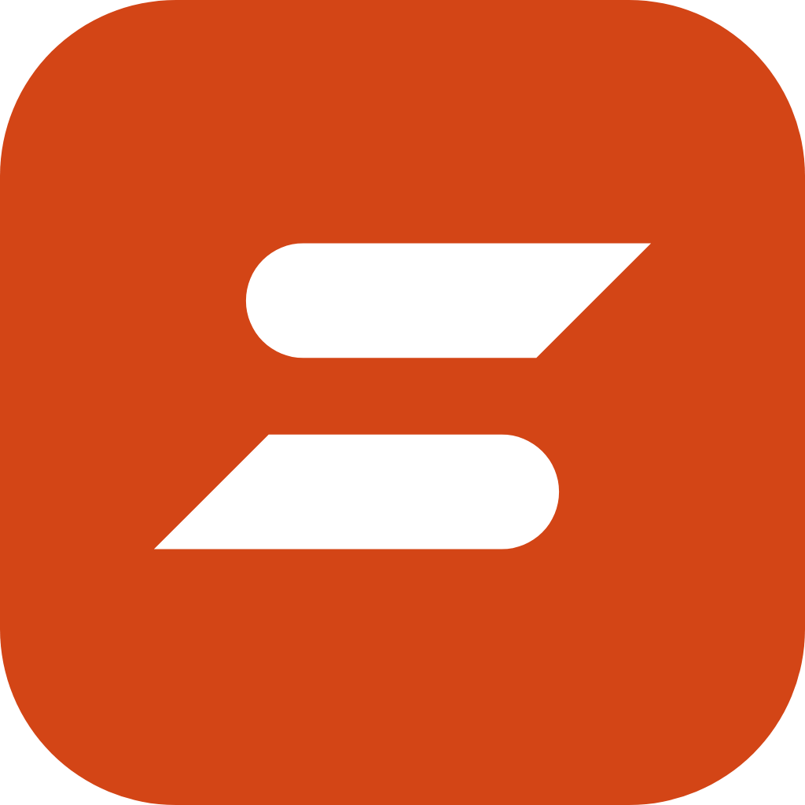
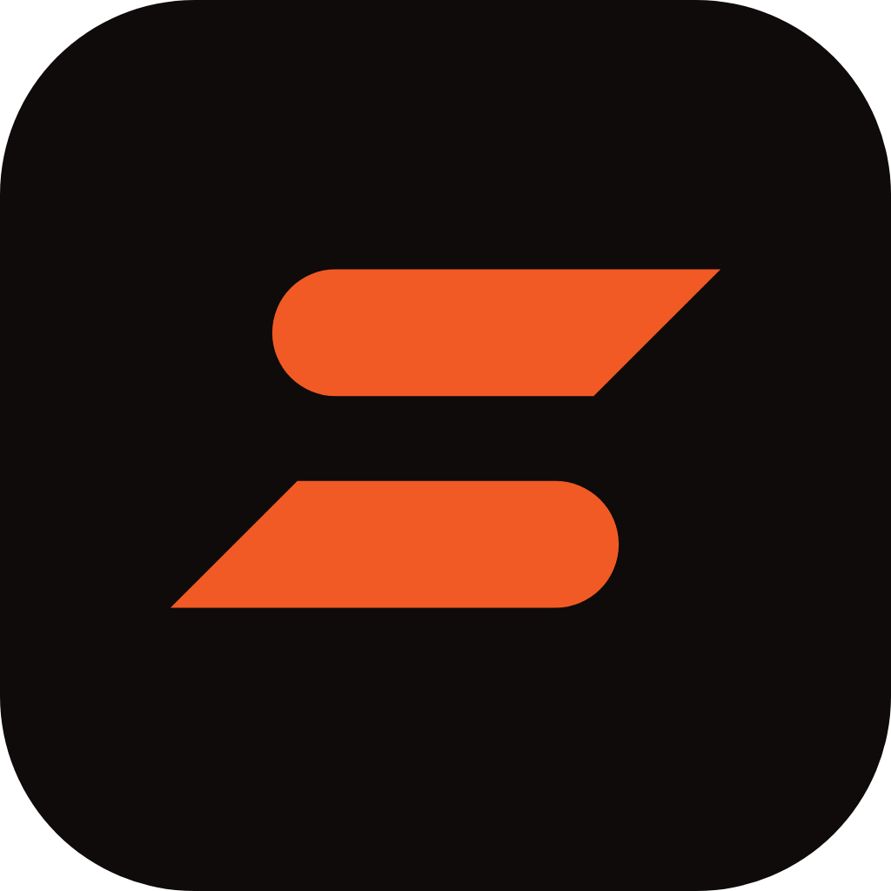

# Brand mark — "Balance"

Two equal bars moving in opposite directions. Each bar is rounded on the end where money leaves
and sheared on the end it moves toward. Money moves, and the total stays equal: double entry in
one shape. The mark is plain geometry with no letterform, so it works in Latin and Cyrillic and
next to any product name.

| | |
|---|---|
|  |  |

## Files

| File | Use |
|---|---|
| `svg/mark-rust.svg` | **Master.** The mark on light or dark backgrounds |
| `svg/mark-white.svg`, `svg/mark-black.svg` | One-colour versions: on photos, rust, print, embossing |
| `svg/mark-small-rust.svg` | Small-size cut with thicker bars and wider gaps. Use it at **32 px and below** |
| `svg/app-icon-rust.svg` | Primary tile: a white mark on rust (rx 56 on 256) |
| `svg/app-icon-dark.svg` | Dark tile: a bright-rust mark on night |
| `svg/app-icon-small.svg` | The tile with the small cut, for favicons |
| `png/favicon.ico` (16/32/48), `png/favicon-*.png` | Browser tabs |
| `png/apple-touch-icon.png` (180) | iOS home screen. Full-bleed, because iOS rounds the corners |
| `png/icon-192.png`, `png/icon-512.png`, `png/maskable-512.png` | Web manifest. The maskable icon keeps the mark inside the 80 % safe circle |
| `png/*-1024.png` | Slides, store listings, social |

### Where the mark is used in the repo

| File | What it holds |
|---|---|
| `console/src/brand.tsx` | Console top bar and login (`BrandMark`) |
| `console/index.html` | Console favicon, inlined |
| `mobile/app/src/main/res/drawable/brand_mark.xml` | In-app tile (`BrandMark()` in `Components.kt`) |
| `mobile/app/src/main/res/drawable/ic_launcher_foreground.xml` | The Android adaptive launcher icon. The `mipmap-anydpi-v26` icons use it as the foreground and as the monochrome themed icon |
| `docs/pitch.html` | Pitch deck |

All of them use the same path data. If the geometry changes, change every file in that list.

## Geometry

The mark is drawn on a 256 grid:

- The bars are 48 units thick, with a 32-unit gap between them. The ends are r = 24 round
  caps and 45° shears.
- Each bar is 145.5 units long along its centre line. The bottom bar is the top bar rotated
  180°, so the two are identical.
- The small cut uses 58-unit bars with a 38-unit gap.
- On a tile, the mark is scaled to 0.76 and lifted 2 units above the geometric centre. This is
  optical centring.

```
M86.5 62H232L184 110H86.5A24 24 0 0 1 86.5 62ZM72 142H169.5A24 24 0 0 1 169.5 190H24L72 142Z
```

## Colour

| Token | Hex | Use |
|---|---|---|
| Rust | `#D34516` | The primary mark and the tile background |
| Rust bright | `#F15A24` | The mark on night (`#0E0B0A`), and gradients |
| Night | `#0E0B0A` | Dark surfaces, the same as the console and app background |
| White | `#FFFFFF` | The mark on rust |

White on rust has a contrast ratio of 4.5:1, rust on night 4.3:1, and bright rust on night
5.8:1. All three clear the 3:1 minimum for graphics.

## Clear space and minimum size

- Clear space: keep at least one bar thickness (48/256 of the mark's box) clear on every side.
- Minimum size: the regular mark down to 24 px. Below that, use the small cut, which stays
  legible at 16 px.

## Don't

- Don't rotate or mirror the mark. Its direction of travel is part of the meaning.
- Don't change the bars' lengths or thicknesses, or move them apart. They must stay equal.
- Don't add outlines, shadows, bevels or gradients to the mark itself. A gradient is fine on the
  tile.
- Don't put the rust mark on a mid-tone background. Use white or black there instead.
- Don't set a product name inside the tile. A wordmark lockup comes once the product name is
  final.

## Web `<head>`

```html
<link rel="icon" href="/favicon.ico" sizes="48x48">
<link rel="icon" href="/favicon.svg" type="image/svg+xml">  <!-- svg/app-icon-small.svg -->
<link rel="apple-touch-icon" href="/apple-touch-icon.png">
<meta name="theme-color" content="#0E0B0A">
```
